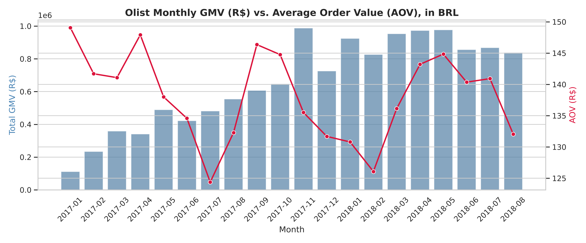
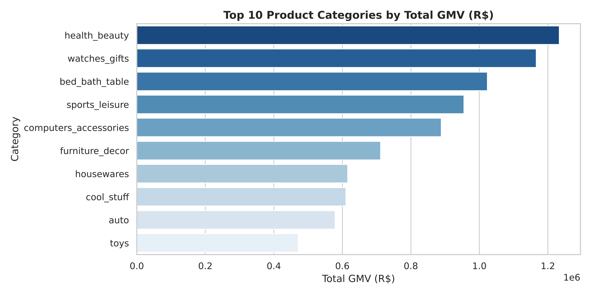
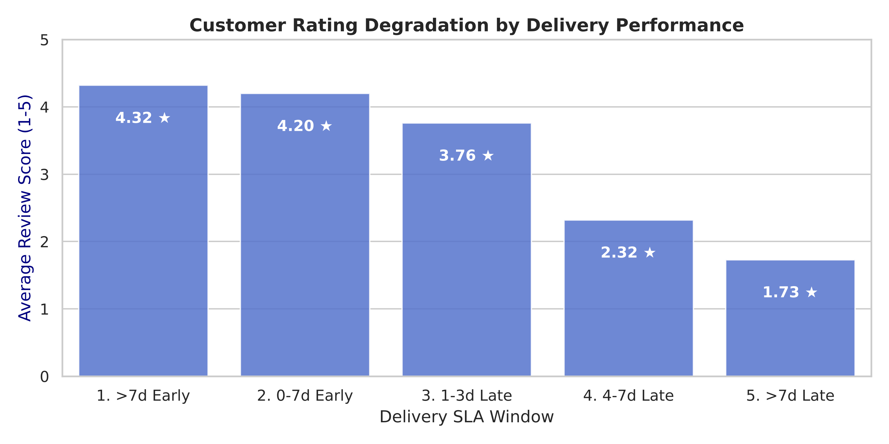
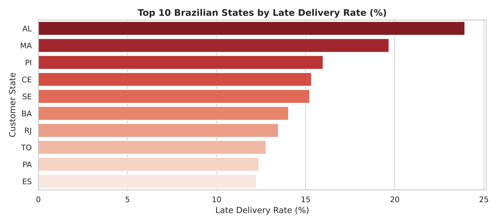
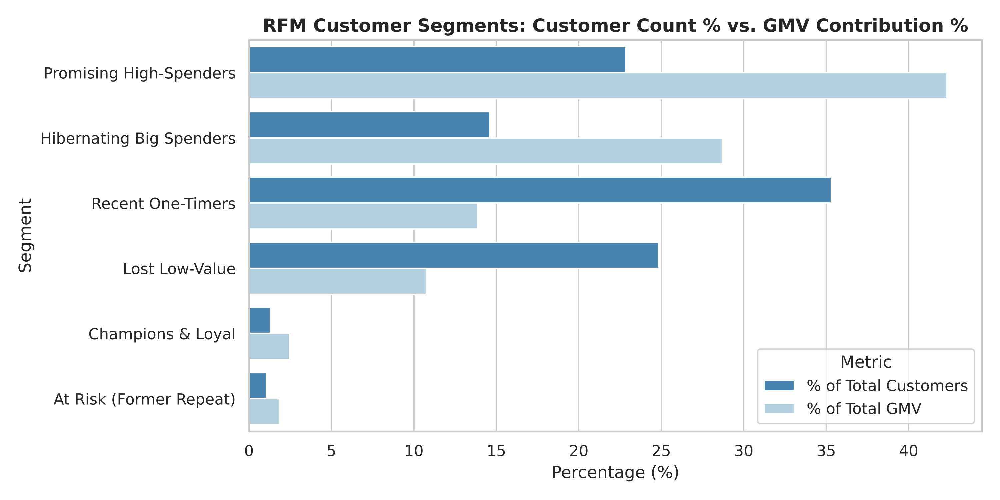
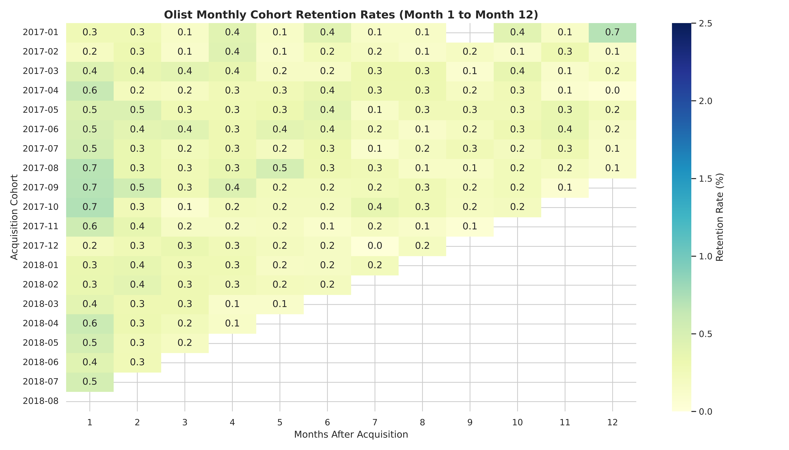

# E-Commerce Business Analytics — Olist (Brazil)

End-to-end business analysis of **~99K orders (2016–2018)** from Olist, a Brazilian e-commerce marketplace, using **SQL (SQLite) + Python**. The project answers three business questions:

1. **Growth** — How are revenue (GMV), order volume and AOV trending, and which categories drive revenue?
2. **Operations** — How much do late deliveries hurt customer satisfaction, and where are the delivery problems?
3. **Customers** — How many customers come back, and which segments should marketing prioritise?

> All monetary values are in **Brazilian Real (R$)**.

---

## Key Findings

| Area | Finding |
|---|---|
| Delivery vs. satisfaction | **8.1%** of delivered orders arrive late. Late orders average **2.57★ vs 4.29★** on-time, and **52.9%** of late orders get a 1–2★ review (vs 9.1%). |
| Delay threshold | Ratings hold up for 1–3 days late (3.76★) but **collapse after 4+ days** (2.32★ → 1.73★; 67% one-star when >7 days late). |
| Regional gaps | North-east states are worst: **AL 23.9%, MA 19.7%** late rate vs ~8% overall. North/Northeast pay **R$16–22 more freight** per order than the Southeast (Tukey HSD, p < 0.001). |
| Retention | **97% of customers buy only once**; month-1 cohort retention is **< 1%**. Repeat customers spend ~1.9× more (R$260 vs R$138). |
| Segments | "Promising High-Spenders" + "Hibernating Big Spenders" are **37% of customers but 71% of GMV** — the highest-value win-back pool. |
| Categories | Health & Beauty (R$1.23M), Watches & Gifts (R$1.17M) and Bed/Bath/Table (R$1.02M) lead GMV; Bed/Bath/Table has the lowest rating of the top 10 (3.92★). |
| Payments | Installments correlate with basket size (Spearman ρ = 0.45) — larger orders are financed. |

## Recommendations

1. **Fix the 4-day cliff:** add proactive alerts + compensation (voucher) for orders projected to be ≥ 4 days late — this is where ratings collapse.
2. **Regional logistics:** renegotiate carriers / add fulfilment capacity for AL, MA, PI, CE, SE; pad delivery estimates there so promises are realistic.
3. **Retention program:** a second-purchase campaign (30–60 days after first order) targeting high-spend one-timers — even +1 pp repeat rate is material given 97% are one-time.
4. **Category quality:** review seller quality in Bed/Bath/Table, a top-3 revenue category with below-average ratings.
5. **Test installment offers** on high-ticket categories (A/B test, since the correlation is not causal).

---

## Dashboard Charts

| | |
|---|---|
|  |  |
|  |  |
|  |  |

Result tables (CSV) are in [`reports/tables/`](reports/tables).

---

## Approach

```
Raw CSVs (9 tables) ──► SQLite DB ──► Order-grain mart (1 row / order) ──► KPIs, RFM, cohorts, stats tests ──► Charts + tables
```

- **Data model:** `sql/02_analytical_base_table.sql` builds `mart_orders_operational` by pre-aggregating items, payments and reviews before joining to orders — avoiding join fan-out.
- **Data validation:** `build_and_validate_abt.py` asserts (1) exactly one row per order and (2) mart GMV equals raw item GMV (no revenue duplication).
- **Business metrics (SQL):** GMV, AOV, MoM growth (window functions `LAG`), category and seller performance, SLA and freight burden by state.
- **Customer analytics:** repeat-purchase rate, **RFM segmentation**, monthly **cohort retention** matrix.
- **Statistics:** Mann-Whitney U (late vs on-time ratings, rank-biserial r = 0.55), one-way ANOVA + Tukey HSD (freight by region), Spearman correlation (installments vs order value).

**Assumptions:** only `delivered` orders are analysed; trend analysis uses Jan 2017–Aug 2018 (earlier/later months are incomplete); "late" = delivered after the estimated date. Results are observational — associations, not proven causation.

## Tech Stack
SQL (SQLite — CTEs, window functions, aggregations) · Python (pandas, NumPy) · matplotlib / seaborn · SciPy / statsmodels

## Project Structure
```
├── data/raw/                     # place Kaggle CSVs here (not committed)
├── sql/
│   ├── 02_analytical_base_table.sql
│   ├── 03_business_metrics.sql
│   └── 04_operations_metrics.sql
├── load_data.py                  # CSV -> SQLite + indexes
├── build_and_validate_abt.py     # build mart + integrity checks
├── run_business_analytics.py     # growth & category KPIs
├── run_operations_analytics.py   # delivery SLA analysis
├── run_customer_analytics.py     # retention, RFM, cohorts
├── run_statistical_tests.py      # hypothesis tests
├── run_pipeline.py               # runs everything in order
└── reports/  figures/ + tables/
```

## How to Run
1. Download the dataset from Kaggle: [Brazilian E-Commerce Public Dataset by Olist](https://www.kaggle.com/datasets/olistbr/brazilian-ecommerce) and put the 9 CSVs in `data/raw/`.
2. Install and run:
```bash
pip install -r requirements.txt
python run_pipeline.py
```

---
**Author:** Bharat Arora · [LinkedIn](https://linkedin.com/in/bharat-arora-8b25a12a0) · [GitHub](https://github.com/b-arora)
